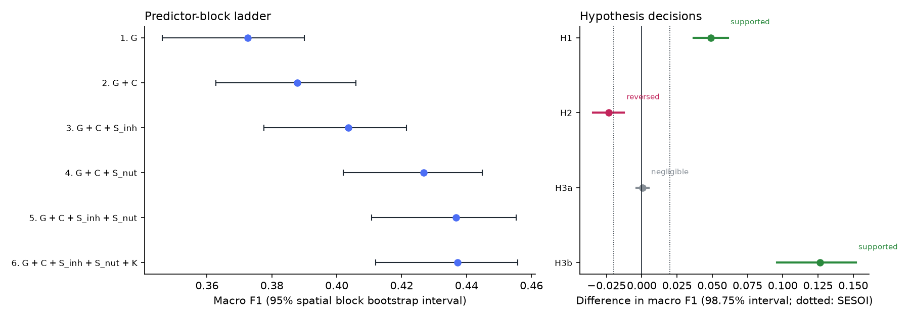
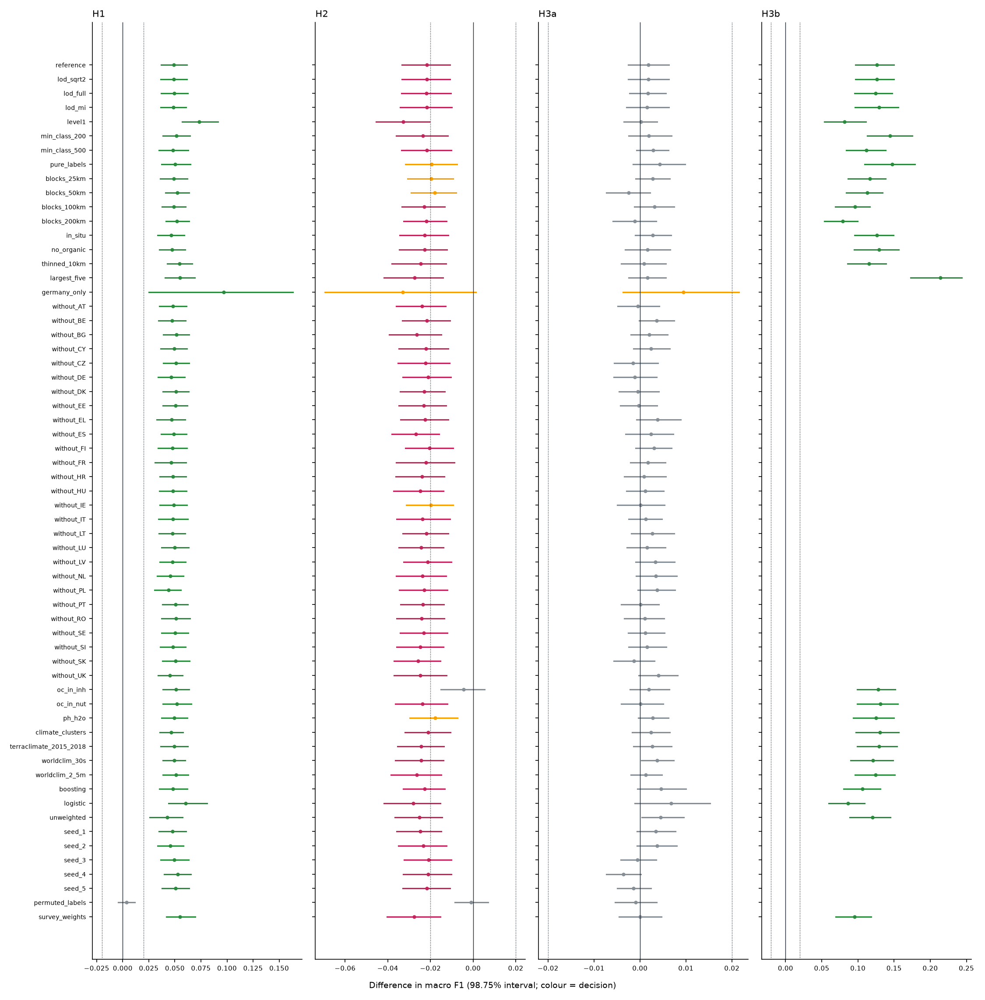

# Soil, Climate and Crop Allocation in European Agriculture

**Which crop is grown where in European agriculture, and what do laboratory soil
measurements add to the predictive performance of a crop-allocation model, beyond
free climate and geographic information?**

A pre-registered predictive study on 9,906 agricultural points of the EU's LUCAS
2018 topsoil survey: the crop group recorded in the field, laboratory-measured
soil chemistry and texture, and climate and terrain at each point.

> **Status.** Phases 0 to 5 of the [analysis protocol](docs/PROTOCOL.md) are
> complete: data audit, sealed split, exploratory analysis, model selection,
> hypothesis tests, interpretation and 61 sensitivity runs. The results below
> are cross-validated on the training points. The sealed test set (1,981 points)
> has not been scored yet; its single score will be added here in Phase 6.

## Key findings

| | Question | Estimate (macro F1) | Decision |
|---|---|---|---|
| **H1** | Do laboratory soil data add to climate and location? | **+0.049** (98.75% interval 0.037 to 0.061) | Supported; robust in all 59 sensitivity runs |
| **H2** | Do inherent soil properties add more than nutrients? | **−0.023** (−0.035 to −0.013) | Reversed: nutrients add more. Sensitive to where organic carbon is assigned (see below) |
| **H3a** | Does country add anything beyond climate, location and soil? | +0.001 (−0.004 to 0.005) | Negligible |
| **H3b** | Does the model transfer to a country it has not seen? | **−0.127** (loss; −0.152 to −0.096) | Supported: transfer is much harder than mapping within the surveyed countries |

- **Soil data help, modestly.** Macro F1 rises from 0.388 (climate and location)
  to 0.437 (plus soil), against 0.371 for location alone and 0.054 for always
  predicting the largest class. The gain is 2.5 times the smallest effect of
  interest set in advance (0.02).
- **The nutrient advantage is an organic-matter signal, not a fertiliser
  signal.** The most important soil variable is total N, not P or K, and total N
  moves almost one-for-one with organic carbon (Spearman ρ = 0.94; the C:N ratio
  is about 9 in every crop group). The nutrient block helps most for permanent
  grassland, whose soils hold the most organic matter. When organic carbon is
  added to the inherent block, the gap between the blocks disappears (−0.004,
  negligible). Organic matter itself reflects land use, so neither reading
  identifies a cause.
- **Climate carries most of the information**, especially for olive groves and
  vineyards, then location, then nutrient soil, then inherent soil.
- **Performance depends on distance to the training data.** Mapping EU farmland
  between the sample points (median 10 km to the nearest sample) gives macro F1
  0.437; with 200 km blocks held out it falls to 0.389, and for an unseen
  country to 0.310. Spain loses most (0.45 to 0.20), although the other countries
  cover 97.5% of its climate and soil conditions, so what fails to transfer is
  more likely country-specific practice than environment.
- **Eight crop groups are hard to separate.** Permanent grassland (F1 0.76) and
  olive groves (0.61) are recognised well; fodder (0.20) and oilseeds and pulses
  (0.29) are not. Wheat is confused with oilseeds and maize, olive groves with
  vineyards, and errors cluster in space (Moran's I 0.14).



## Approach

**Data.** LUCAS 2018 topsoil samples (0-20 cm) on cropland or grassland under
agricultural use, joined to the harmonised LUCAS land-cover record and to
climate, terrain and texture at each point. The sample flow, from 18,984 soil
samples to 9,906 points, is in
[`reports/tables/sample_flow.csv`](reports/tables/sample_flow.csv).

**Target.** Eight crop groups, each with at least 300 points: wheat (1,768),
other cereals (1,551), maize and root crops (1,094), oilseeds and pulses (973),
fodder and temporary grassland (708), permanent grassland (2,802), vineyards and
orchards (567) and olive groves (443).

**Predictor blocks.**

| Block | Variables |
|---|---|
| G, geography and terrain | Projected coordinates, elevation and slope (Copernicus DEM GLO-90) |
| C, climate | Six bioclimatic variables from TerraClimate 1991-2020 normals |
| S-inh, inherent soil | pH (CaCl₂), carbonate, clay and silt |
| S-nut, nutrient soil | Total N, extractable P and K, a P-below-detection flag |
| K, country | Country |

**Validation designed for the use case.** The model is meant to map unsampled
farmland inside the EU. Folds are built with k-fold nearest-neighbour distance
matching (kNNDM), so the distances between held-out and training points match
those between EU farmland and the sample. A sealed test set of 1,981 points was
fixed by kNNDM before any exploration; the SHA-256 hash of its point IDs is in
[`reports/tables/split_seal.csv`](reports/tables/split_seal.csv), committed
before the exploratory analysis.

**Inference.** Every comparison is paired on the same points and folds, with
uncertainty from a spatial block bootstrap (175 km blocks, set from the class
variograms). Decisions use 98.75% intervals (95% adjusted for four tests)
against a smallest effect of interest of 0.02 macro F1, and Holm-adjusted
p-values.

**Model selection.** Random forest, chosen by the one-standard-error rule over
logistic regression on spline bases and gradient boosting, with equal tuning
budgets in nested cross-validation (macro F1 0.440, against 0.433 for boosting).

**Pre-registration.** The protocol, with its hypotheses, estimands and decision
rules, was committed before modelling. Every later change is a dated amendment
(A1-A18) in the protocol, including the ones made after a pipeline check.

## Robustness

The decisions were repeated in 61 sensitivity runs: detection-limit handling,
target definition, block sizes instead of kNNDM, sample restrictions, each
country left out in turn, climate source and resolution, other algorithms,
model seeds, survey reweighting and two negative controls
([`reports/tables/sensitivity_summary.csv`](reports/tables/sensitivity_summary.csv)).

| | Runs disagreeing with the primary decision | Verdict |
|---|---|---|
| H1 | 0 of 59 | Robust |
| H2 | 7 of 59 (6 inconclusive at the threshold or in Germany alone; 1 negligible: organic carbon in the inherent block) | Fragile on the pre-set rule; the direction holds in 58 of 59 |
| H3a | 1 of 59 (Germany only) | Mostly robust |
| H3b | 0 of 26 | Robust |

The negative controls behave as they should. A pure-noise variable has an
importance of 0.002. With labels shuffled within each country, the model scores
0.226, the level of a model that knows only each country's crop mix (0.216), and
soil adds nothing (H1 +0.004).



## Limitations

- **One year, one crop.** Each point records the crop of 2018. Rotations put
  different crops on the same soil, which caps how well arable groups can be told
  apart.
- **Associations, not causes.** Soil nutrients and organic matter reflect past
  management as well as soil type, so the results say what predicts crop
  allocation, not what drives farmers' choices.
- **Texture from earlier surveys.** Clay and silt come from the 2009-2015
  surveys at the same point, measured for 91% of the points.
- **Calibration.** Class weighting shifts probability away from permanent
  grassland (class-wise calibration error 0.06 after temperature scaling).
  Decisions use predicted classes and are not affected; any map of probabilities
  should carry this caveat.
- **The E1 plateau rule.** The pre-registered rule returns 25 km because macro F1
  barely changes from 25 to 50 km blocks, but it falls again by 0.017 at each
  doubling beyond 50 km. Performance keeps declining with distance up to 200 km.

## Repository layout

```
config/analysis.yaml   every fixed choice: filters, blocks, splits, budgets, seeds
docs/PROTOCOL.md       the pre-registered protocol and its amendments
src/eusoil/            the pipeline (python -m eusoil <command>)
tests/                 unit tests on synthetic data; run in CI on Linux and Windows
reports/tables/        aggregated results (no point-level soil data)
reports/figures/       figures (soil values shown only as medians of 50 km cells)
data/README.md         how to obtain each source; data/ itself is not committed
```

## Reproducing the pipeline

Requires Python 3.12 or later (developed on 3.14). The LUCAS soil data must be
requested from ESDAC; [`data/README.md`](data/README.md) lists every source and
where to put it.

```bash
python -m venv .venv
# Windows (PowerShell): .venv\Scripts\Activate.ps1   macOS / Linux: source .venv/bin/activate
pip install -r requirements.txt
pip install -e .
python -m pytest            # unit tests on synthetic data; no licensed data needed
```

Then run the phases in order (`python -m eusoil <command>`). Long steps save
each finished fold and resume if interrupted.

| Phase | Commands |
|---|---|
| 1. Data | `points`, `dem`, `terraclimate --period 1991-2020`, `terraclimate --period 2015-2018`, `worldclim` (optional internal check), `table`, `precision` |
| 2. Split and exploration | `domain`, `seal` (refuses to re-seal), `variogram`, `folds`, `eda` |
| 3. Model selection | `stage-a`, `stage-a-report` |
| 4. Hypothesis tests | `stage-b-ladder`, `stage-b-validation`, `stage-b-report` |
| 5. Interpretation and robustness | `interpret`, `sensitivity`, `sensitivity-report` |

## Related project

[Soil Carbon Kriging](https://github.com/aolagoke-dsae/soil-carbon-kriging) works
at the opposite end of the scale: it maps soil organic carbon within single fields
by kriging, with the uncertainty of each prediction and of each field's mean
stock. This project classifies crop allocation across the EU and tests what each
block of predictors adds.

## Data and licences

LUCAS 2018 topsoil data: European Soil Data Centre (ESDAC), European Commission,
Joint Research Centre. Orgiazzi, A., Ballabio, C., Panagos, P., Jones, A. &
Fernández-Ugalde, O. (2018). LUCAS Soil, the largest expandable soil dataset for
Europe: a review. *European Journal of Soil Science*, 69(1), 140-153. The soil
data are not redistributed here; the repository contains code, configuration and
aggregated results only.

Land cover: d'Andrimont, R. et al. (2020). Harmonised LUCAS in-situ land cover and
use database for field surveys from 2006 to 2018 in the European Union.
*Scientific Data*, 7, 352. Climate: TerraClimate (Abatzoglou et al., 2018),
public domain under CC0. WorldClim 2.1 (Fick & Hijmans, 2017) serves only as an
internal resolution check: its licence does not allow redistribution, so no
value derived from it is published here. Elevation: Copernicus DEM GLO-90
© DLR e.V. 2010-2014 and © Airbus Defence and Space GmbH 2014-2018, provided
under COPERNICUS by the European Union and ESA. Boundaries: © EuroGeographics
for the administrative boundaries (GISCO NUTS 2016).

## Author

**Dr. Adewole Olagoke** · [aolagoke-dsae](https://github.com/aolagoke-dsae)

Code licensed under the MIT License (see `LICENSE`).
