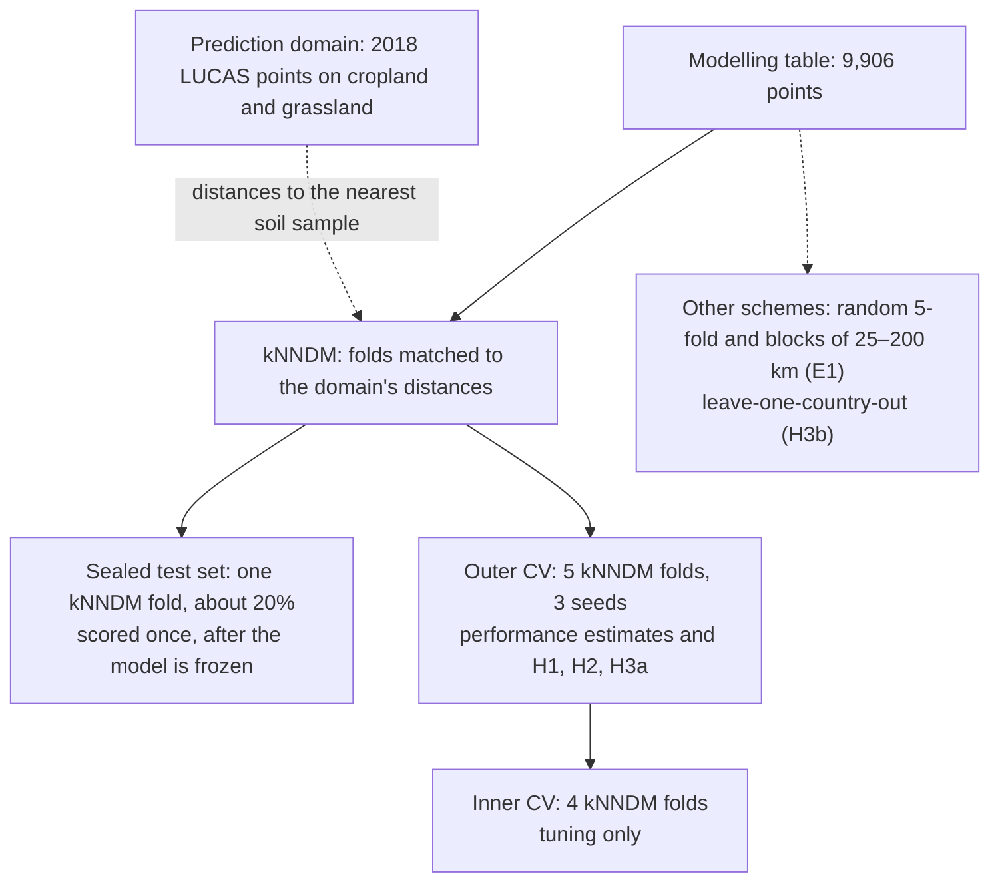

# LUCAS Crop Allocation: Analysis Protocol

Dr. Adewole Olagoke · 10 November 2026 · revision 90

## Purpose and scope

This protocol fixes every analytical decision before the soil data are modelled, so results cannot be steered by choices made after seeing them. It is committed to the repository (timestamped) before the sealed test set is first used.

**Central question.** Which crop is grown where in European agriculture, and what do laboratory soil measurements add to the predictive performance of a crop-allocation model, beyond free climate and geographic information?

**Unit of analysis.** One LUCAS 2018 survey point with a topsoil sample (0–20 cm), on agricultural land (arable, permanent crops or grassland), with the crop or land cover recorded by the surveyor that year.

**Prediction domain.** The model is meant to predict the crop group on unsampled agricultural land within the EU member states surveyed in 2018, represented by the 2018 LUCAS survey points on cropland and grassland (the harmonised land-cover file). Prediction for a country with no training data is a secondary target, tested by H3b. Validation is designed for these two targets (see Validation design).

**What it is not.** It is not a crop *recommendation* model. The target is an observed outcome (what a farmer grew), which reflects suitability, economics, policy and rotation together. The analysis is explanatory and comparative first, predictive second.

**Prior work.** [Szigeti et al. (2023)](https://orgprints.org/id/eprint/52239/) mapped where ten major crops are grown from LUCAS 2006–2018 and compared Olsen P between them, describing soil P as an indicator of cultivation intensity. [Tóth et al. (2014)](https://publications.jrc.ec.europa.eu/repository/handle/JRC88111) related cropland P to yields and fertiliser use. Both are descriptive. This project asks how much laboratory soil measurements add to a validated prediction of crop allocation, beyond climate and geography, under validation matched to the prediction domain.

**Related project.** [Soil Carbon Kriging](https://github.com/aolagoke-dsae/soil-carbon-kriging) works at the opposite end of the scale: it maps soil organic carbon within single fields by kriging, with the uncertainty of each prediction and of each field's mean stock. This project classifies crop allocation across the EU and tests what each block of predictors adds. The README of each project states this distinction in two or three sentences and links to the other.

## Amendments from the data audit and review, 10 November 2026

The data were screened before this protocol was committed. Everything below was decided from data structure and documentation only, before any relationship between predictors and crops was examined. The configuration file `config/analysis.yaml` implements each rule.

| No. | Change | Reason | Applies to |
| --- | --- | --- | --- |
| A1 | Every measurement below its limit of detection (OC 2.0 g/kg, N 0.2 g/kg, P 10 mg/kg, K 10 mg/kg, EC 0.1 mS/m) is censored at the limit, whether reported as `< LOD` or as a number, substituted by 0.5 × LOD and flagged | The file contains numbers below the documented limits (P as low as 0.3); the JRC report (Table 3) gives the limits | Data quality |
| A2 | CaCO₃ codes `NA` and `< LOD` both mean 0 g/kg, with a carbonate-present flag; nothing is imputed | The 2018 readme defines them as "absent" for pH below and above 7 | Feature block S-inh |
| A3 | Elevation and slope come from the Copernicus DEM GLO-90, read at the points; the survey's elevation field is not used | It holds the code 8888 and about 400 values above 10,000 | Feature block G |
| A4 | Texture is taken from the same point in an earlier survey (mostly 2009) and treated as fixed; 9,056 of 9,906 points have it | Texture changes over decades, not years | Feature block S-inh; sensitivity run restricted to measured texture |
| A5 | Units of analysis: 0–20 cm samples, land use U111 (agriculture without fallow and kitchen gardens), Malta excluded (2 points); crop groups as in the Target definition table | Land-use and depth filters remove non-agricultural and non-standard samples; Malta is too small to model or hold out | Target; sample flow |
| A6 | Coordinates: the GPS fix where the point was observed in the field and the fix lies within 100 m of the planned position; otherwise the planned position (19 points) | The GPS columns contain placeholder values (0, 88.88889) | Every spatial step |
| A7 | Climate: bioclimatic variables computed from TerraClimate 1991–2020 monthly normals (WorldClim's definitions) are primary; TerraClimate 2015–2018 is the climate-period sensitivity run; WorldClim 2.1 (30 arc-seconds and 2.5 minutes) is an internal resolution check only, and no WorldClim value or derived value is published | TerraClimate is public domain (CC0); WorldClim allows no redistribution without permission, and the dashboards would redistribute derived values | Feature block C; sensitivity runs; dashboards |
| A8 | Oxalate Al and Fe are dropped; pH (H₂O) is kept only for its sensitivity run | Oxalate is measured for about 13% of points | Data quality |
| A9 | Boundaries: GISCO NUTS 2016 | The soil file's NUTS codes follow the 2016 edition | Maps; leave-one-country-out |
| A10 | The prediction domain is stated: unsampled farmland within the EU is the primary target, a new country the secondary one (H3b). The primary cross-validation uses kNNDM folds matched to that domain; fixed square blocks become sensitivity runs | Whether random or spatial cross-validation is biased depends on where the model will predict (Wadoux et al., 2021; Milà et al., 2022; Meyer & Pebesma, 2022) | Validation design; H1, H2, H3a |
| A11 | The former H4 (random CV overstates accuracy) becomes estimate E1: macro F1 against distance to the nearest training point, with a numeric plateau rule | H4 assumed its own answer: the gap between random and spatial CV measures how hard it is to predict away from the samples, not a leak | Hypotheses; validation |
| A12 | The former H3 (P and K higher under high-input crops) is set aside for this version | The pattern is documented for LUCAS (Tóth et al., 2014; Szigeti et al., 2023); LUCAS P is Olsen P, whose extraction behaves differently in acid soils; a residual-Moran's-I criterion cannot pass with about 9,900 points | Hypotheses; interpretation; dashboards |
| A13 | Hypotheses renumbered H1, H2, H3a, H3b (the former H5a, H5b). Holm covers these four tests. Each is decided as supported, negligible or inconclusive against the 0.02 SESOI from 98.75% intervals; H2 now has the threshold too | The former count of five tests was wrong (seven with P and K, H5a and H5b); H2 had no threshold | Hypotheses; inference |
| A14 | ERA5-Land in the risks table replaced by TerraClimate; texture source in the data-ingestion table aligned with A4 | Left over from earlier drafts | Data ingestion; risks |

The resulting sample flow (18,984 points to 9,906) is in `reports/tables/sample_flow.csv`.

**How to use this document.** Sections run in execution order. Each section states the decision, the reason, and the check that confirms it was followed. Items marked *confirm on receipt* depend on the actual files (column names, units, counts) and are settled in the data audit, not later.

## Research questions and hypotheses

Four hypotheses and one pre-specified estimate are fixed in advance. H1 is primary; H2, H3a and H3b are secondary; E1 is an estimate with a decision rule but no test. Each hypothesis has one estimand, one test and a decision rule stated before any result is seen. Predictor blocks are abbreviated G (geography and terrain), C (climate), S-inh (inherent soil), S-nut (nutrient soil) and K (country); they are defined in the Feature engineering section.

The smallest effect of practical interest (SESOI) for any difference in predictive performance (in macro F1, between two predictor sets or two validation schemes) is **0.02 macro F1**, estimated under the primary cross-validation (kNNDM folds, see Validation design).

**Decision rule.** Each hypothesis is decided from a 98.75% interval of its estimand Δ (95% with a Bonferroni adjustment for four tests):

| Decision | Rule |
| --- | --- |
| Supported | Lower bound > 0 and point estimate ≥ 0.02 |
| Negligible | Upper bound < 0.02 (for H2: the whole interval within ±0.02) |
| Inconclusive | Neither of the above |
| Reversed (H2 only) | Upper bound < 0 and point estimate ≤ −0.02 |

| ID | Hypothesis | Estimand Δ | Test |
| --- | --- | --- | --- |
| H1 (primary) | Laboratory soil measurements add to the predictive performance of the crop-allocation model beyond geography and climate | Macro F1 (G + C + S-inh + S-nut) − macro F1 (G + C), same algorithm, primary CV | Paired spatial block bootstrap of the outer-fold difference (2,000 resamples) |
| H2 | Inherent soil properties (pH, CaCO₃, texture) add more predictive performance than nutrient measurements (N, P, K), each block added on top of geography and climate | Gain of S-inh over G + C minus gain of S-nut over G + C | Same bootstrap, on the paired difference of the two gains |
| H3a | Country adds predictive performance beyond geography, climate and soil | Macro F1 (G + C + S-inh + S-nut + K) − macro F1 (G + C + S-inh + S-nut) | Same bootstrap |
| H3b | A model trained on other countries predicts an unseen country less accurately than unsampled farmland within the surveyed countries | Macro F1 (primary CV) − macro F1 (leave-one-country-out), same model | Same bootstrap; per-country transfer table |

**E1, performance against prediction distance (an estimate, not a test).** The final configuration is scored under random 5-fold CV, kNNDM CV, square blocks of 25, 50, 100 and 200 km, and leave-one-country-out. Each score is plotted against the median distance from evaluation points to their nearest training point, with the prediction domain's own median distance (EU farmland to the nearest soil sample) marked. E1 gives the score expected for an EU map and how fast it falls away from the samples. **Plateau rule:** the curve has reached a plateau at the first block size beyond which doubling the size changes macro F1 by less than 0.02, with the 95% interval of that change inside ±0.02. No plateau up to 200 km is reported as such.

**Set aside: a fertilisation signature in P and K.** An earlier draft tested whether P and K are higher under high-input crops than under permanent grassland after adjustment. It is not part of this version, for three reasons:

- The pattern is already documented for LUCAS (Tóth et al., 2014; Szigeti et al., 2023), so it would be a replication.
- LUCAS P is Olsen P, a bicarbonate extraction at pH 8.5 that behaves differently in acid soils. Crop groups differ in pH, so a straight-line pH term would let the crop contrast absorb the method's bias.
- A criterion of non-significant residual Moran's I cannot pass with about 9,900 points.

If revisited, it is exploratory, with smooth terms for pH and CaCO₃ and a spatial random effect. Descriptive P and K summaries per crop group stay in the EDA.

**Multiplicity.** Holm correction across the four tests H1, H2, H3a and H3b, with Holm-adjusted p-values reported beside the decisions. Everything else (per-variable, per-crop, per-country tests) is labelled exploratory and controlled with Benjamini–Hochberg at 10% FDR.

**Causal language.** The analysis is predictive and cross-sectional. A block that adds predictive performance is reported as informative about where crops are grown, not as a cause of the farmer's choice; soil nutrients in particular reflect past management as well as soil type.

## Data ingestion and lineage

All sources are joined on the LUCAS `POINT_ID`, and every step records how many points enter and leave it. Raw files are never edited; every derived file is regenerated by code.

| Source | Content used | Access and licence | Join |
| --- | --- | --- | --- |
| LUCAS 2018 topsoil (ESDAC) | pH (CaCl₂, H₂O), organic carbon, CaCO₃, total N, extractable P and K, EC; sampling depth | Request form; personal, non-transferable licence. **Raw values may not be published.** | `POINT_ID` |
| LUCAS 2018 harmonised land cover and use (d'Andrimont et al., 2020) | Land cover `LC1` (crop code), land use `LU1`, theoretical and GPS coordinates, observation distance and type, survey date; all 2018 points on cropland and grassland also define the prediction domain | Open download | `POINT_ID` |
| LUCAS topsoil texture (ESDAC, from the 2009, 2012 and 2015 surveys) | Clay, silt, sand, measured at the same point in an earlier survey (A4) | Same request as topsoil | `POINT_ID` |
| TerraClimate (Abatzoglou et al., 2018), monthly, about 4 km | Bioclimatic variables computed from 1991–2020 monthly normals (primary) and from 2015–2018 (sensitivity) | Public domain (CC0); read from the Microsoft Planetary Computer | Nearest cell with data |
| WorldClim 2.1 bioclimatic variables (30 arc-seconds and 2.5 minutes) | BIO1–BIO19, internal resolution check only | Free for non-commercial use; redistribution not allowed without permission, so no WorldClim value or derived value is published | Point extraction |
| Copernicus DEM GLO-90 | Elevation, slope | Open, with the required Copernicus attribution | Point extraction |
| Eurostat GISCO NUTS 2016 (the edition the soil file's NUTS codes follow) | Country, NUTS-2 region | Open | Point-in-polygon |

**Coordinates.** Use the GPS position where the point was visited in the field, otherwise the theoretical position. Project to EPSG:3035 (ETRS89-LAEA Europe) for all distances, blocks and variograms. *Confirm on receipt:* coordinate column names and which file carries them.

**Join checks (automated).**

- `POINT_ID` is unique in each source.
- Topsoil → land cover join is 1:1; unmatched points are counted and listed, never silently dropped.
- Sample flow table (counts in, counts out, reason) for every filter, reported as a flow diagram in the write-up.

**Storage layout.**

- `data/raw/`: downloads as received, read-only, with a `MANIFEST.sha256` of checksums.
- `data/interim/`: joined and cleaned tables in Parquet.
- `data/processed/`: the modelling table, one row per point, with the fold assignment column.
- All of `data/` is git-ignored. The repository ships download instructions and the scripts, never LUCAS soil values.

## Data quality and cleaning

Cleaning rules are written as code with a unit test each, and every rule reports how many values or points it changed, overall and by country.

| Issue | Rule | Check or sensitivity |
| --- | --- | --- |
| Values below the limit of detection (`<LOD` strings, mainly P and K) | Parse to numeric; substitute LOD/2 and add a binary below-LOD indicator per variable | Report % below LOD by variable and country. Sensitivity: LOD/√2, LOD, and multiple imputation from a left-truncated log-normal |
| Units | Convert to one documented unit per variable (P and K mg/kg, N and organic carbon g/kg) | *Confirm on receipt:* source units (P is listed in g/kg in one metadata source, which looks wrong for extractable P) |
| Implausible values | Flag outside domain ranges (pH 3–10.5; organic carbon 0–600 g/kg; negative values) | Flagged values are reviewed by hand and excluded only with a documented physical or protocol reason, never deleted automatically |
| Organic soils | Flag points with organic carbon > 120 g/kg (peat-like) | Sensitivity: refit without them |
| Sampling depth | Keep the 0–20 cm standard samples | Count and exclude other depths |
| Location quality | Record observation distance between theoretical and visited point; flag photo-interpreted points (not visited) | Sensitivity: only points observed in the field within 100 m |
| Duplicates | Exact duplicate rows and repeated `POINT_ID` | Must be zero after the join, test fails otherwise |
| Missing values | Tabulate missingness by variable, class and country; inspect whether it clusters (for example texture missing for whole countries) | Primary: complete cases for the variables in the predictor set being modelled, with the number of points lost reported. Sensitivity: iterative imputation inside the training folds only |
| Skewed distributions | log or log1p for organic carbon, N, P, K, EC, CaCO₃ (CaCO₃ is zero-heavy: log1p plus a carbonate-present indicator) | Tree models are unaffected by monotonic transformations; the transformation matters for the logistic baseline |
| Two pH measurements | pH (CaCl₂) is primary; pH (H₂O) is dropped from models, because the two are typically correlated above r = 0.95 | Sensitivity: swap them |

**No row is removed for being an outlier on its own.** A value is only excluded for a documented physical or protocol reason, and the count is in the sample flow table.

## Target definition

The target is modelled at two levels, because arable crops rotate and a one-year crop label is a noisy draw from a multi-year rotation, while the soil reflects the whole rotation.

- **Level 1, farming system (3 classes):** arable land, permanent crops, grassland. Expected to be predicted well from soil and climate, because these systems differ strongly in where they occur.
- **Level 2, crop group (about 8–10 classes):** the main analysis target, grouped from LUCAS `LC1` codes.

Provisional grouping, to be fixed in the data audit from actual counts before any modelling:

| Crop group | LUCAS LC1 codes (2018 nomenclature) | Points after filtering | Input intensity (descriptive) |
| --- | --- | --- | --- |
| Wheat | B11 common wheat, B12 durum wheat | 1,768 | Medium |
| Other cereals | B13 barley, B14 rye, B15 oats, B18 triticale, B19 other cereals | 1,551 | Medium |
| Maize and root crops | B16 maize; B21 potatoes, B22 sugar beet, B23 other root crops | 1,094 | High |
| Oilseeds and pulses | B31 sunflower, B32 rapeseed, B33 soya, B41 dry pulses | 973 | Medium |
| Fodder and temporary grassland | B51–B55 (clover, lucerne, mixtures, mixed cereals for fodder, temporary grassland) | 708 | Low |
| Olive groves | B81 | 443 | Low |
| Vineyards and orchards | B82 vineyards; B71–B77 fruit and nut trees | 567 | Medium |
| Permanent grassland | E10, E20 (grassland with sparse or no tree cover) | 2,802 | Low |

Total: 9,906 points in eight groups. Root crops (248 before filtering) were merged with maize as spring-sown, high-input row crops, and vineyards (297) with orchards as woody permanent crops, so that every group has at least 300 points (decision of 10.11.2026). Excluded, with counts in `reports/tables/audit_excluded_codes.csv`: E30 (spontaneously revegetated land, 192), B35 other fibre and oleaginous crops (44), vegetables, cotton, rice, tobacco and other small codes, nurseries, and BX1 (arable land identified only by photo-interpretation).

*Confirm on receipt:* the exact 2018 code list and labels; the intensity column is an a-priori classification and is written into the code before any analysis and is used only descriptively (A12).

**Rules.**

- Minimum class size: 300 points. Smaller groups are merged with the nearest agronomic group, or dropped with the count reported (rice, cotton, tobacco and vegetables are expected to fall below it).
- Excluded a priori: fallow and bare arable land, greenhouses and nurseries (B83), non-agricultural land, and points whose land use is not agriculture.
- Mixed or uncertain labels (where the survey records a second land cover or a low-confidence observation): kept in the primary analysis, removed in a sensitivity run.

**Label noise is expected, not a bug.** Wheat vs other cereals and oilseeds vs cereals share rotations on the same fields. Misclassification between these groups is reported as an agronomic finding about rotations, and Level 1 results are shown alongside Level 2.

## Feature engineering and predictor blocks

Predictors are organised into five fixed blocks. The hypotheses compare the predictive performance gained from each block, so block membership is decided here and never changed after results are seen.

| Block | Variables | Role |
| --- | --- | --- |
| G: geography and terrain | Easting, northing (EPSG:3035), elevation, slope | Baseline; captures spatial structure and terrain |
| C: climate | A pre-selected subset of bioclimatic variables, computed from TerraClimate 1991–2020 monthly normals with WorldClim's definitions: BIO1 mean temperature, BIO4 temperature seasonality, BIO6 coldest-month minimum, BIO12 annual precipitation, BIO15 precipitation seasonality, BIO17 driest-quarter precipitation | Free, gridded climate information available for any field |
| S-inh: inherent soil | pH (CaCl₂), CaCO₃ (log1p + presence flag), clay, silt (sand is the remainder and is dropped) | Properties that change slowly and little under management |
| S-nut: nutrient soil | Total N, extractable P, extractable K (log), below-LOD flags | Properties that fertilisation changes |
| K: country | Country code | Proxy for policy, markets, subsidies and survey practice |

**Organic carbon** is management-sensitive and soil-type-driven at once, so it sits in neither soil block by default. It enters S-inh in a sensitivity run and S-nut in another, and the H2 conclusion must hold in both.

**Climate subset.** The 19 BIO variables are highly collinear. The six above are chosen a priori to cover temperature level, seasonality, cold limits and water supply; the choice is then checked against a Spearman-correlation cluster analysis on the training data only (one variable per cluster at |ρ| > 0.8). If the cluster analysis selects different variables, the pre-chosen set is kept for the primary analysis and the cluster-based set is run as a sensitivity.

**Encoding and leakage rules.**

- Country is one-hot encoded for tree models. Any target or frequency encoding is fitted inside each training fold.
- No feature may use the crop labels of other points (for example the share of maize among neighbours). That would leak the answer through spatial autocorrelation.
- No derived index that needs the full dataset (PCA scores, scaling parameters, LOD imputation models) is computed outside the training fold.
- Interactions between predictors are learned by the tree models without being specified in advance; the logistic baseline uses natural splines (3 knots) on continuous variables.

## Exploratory data analysis

The sealed test set is assigned first (see Validation design), and all EDA after the data audit runs on the training points only. Otherwise patterns seen in the test data would shape the models and inflate the final score.

**Data audit (all points, before the split).** Only counts and structure, no relationships with the target:

- Sample flow from raw points to the modelling table.
- Class counts overall and by country; points per country.
- Missingness and below-LOD shares by variable and country.

**Exploration (training points only).**

| Topic | Analysis | Why it matters |
| --- | --- | --- |
| Distributions | Histograms and per-class violin plots on the transformed scale; summary table (median, IQR) per class | Shows which variables differ between which crop groups, before any model is fitted |
| Pooled vs within-group structure | Correlation matrices pooled, within crop group and within country | A check for Simpson's paradox: a correlation created by differences between crops or countries must not be read as a soil-chemical relationship |
| Variance partitioning | Share of each variable's variance between countries and between NUTS-2 regions (intraclass correlation from a random-intercept model) | High country ICC means country and soil are confounded, which H3a has to untangle |
| Spatial autocorrelation | Global Moran's I for each predictor and for each class indicator; empirical variograms in EPSG:3035 | The variogram range sets the block size of the bootstrap and is reported beside the kNNDM distances (E1) |
| Collinearity | Spearman correlations, hierarchical clustering of variables, variance inflation factors | Decides the climate subset check and explains why grouped importance is used |
| Environmental coverage | Overlap of each country's climate and soil space with the rest (convex hull or density in PCA space) | Countries outside the others' range will transfer badly in leave-one-country-out; flag them in advance |
| Maps | Point maps of each crop group and each soil variable | Spatial clusters and gaps a reviewer can see at a glance |

**Rules.** EDA can raise new questions, but those are recorded as exploratory and never promoted to the confirmatory hypotheses. Every EDA figure is generated by a script and saved to `reports/figures/`.

## Inferential statistics and hypothesis testing

LUCAS points are spatially dependent, so any test that assumes independent observations understates uncertainty. Every confirmatory test either models the spatial dependence explicitly or resamples whole spatial blocks rather than single points.

**What not to use as evidence.** Plain chi-square, ANOVA, Kruskal–Wallis and McNemar tests on the pooled points. They may be shown descriptively with effect sizes (ε², Cramér's V), never with p-values used as evidence.

**Comparing predictive performance (H1, H2, H3a, H3b; E1).**

1. Each comparison uses the same algorithm, the same folds and the same seeds for both sides, so differences are paired.
2. The uncertainty of a difference in macro F1 comes from a **spatial block bootstrap**: resample whole spatial blocks of the outer-fold predictions with replacement (2,000 resamples) and recompute both scores each time. Report the median difference and the percentile 95% interval.
3. Cross-check with the corrected resampled t-test (Nadeau and Bengio, 2003) over repeated outer folds. If the two disagree on significance, report both and treat the conclusion as weak.
4. Report effect sizes against the SESOI of 0.02, not only p-values.

**Multiplicity and reporting.**

- Holm across the four confirmatory tests (H1, H2, H3a, H3b), with decisions from 98.75% intervals as set out under Research questions. BH (10% FDR) across exploratory tests.
- Every result is reported as estimate, interval, adjusted p-value and the decision under the pre-set rule, including the negligible and inconclusive ones.

**Precision check before modelling.** With the actual class counts, simulate the expected width of the macro-F1 bootstrap interval. If it exceeds 0.04, the interval is too wide to tell a gain of 0.02 (the SESOI) apart from zero; then merge small classes or report H1 as underpowered before looking at results. Done in Phase 1: with 9,906 points in eight groups, the median width is about 0.006 for both 50 km and 100 km blocks (\`reports/tables/precision\_check.csv\`).

## Validation design

Every evaluation separates training and test points by the distances the model will face in use, all model selection happens inside the training folds, and a sealed test set is scored exactly once at the end.



Tuning sees only inner folds, every hypothesis comparison is scored on outer folds, and the sealed test set scores the frozen model once.

**Prediction distances and folds.** The primary cross-validation uses kNNDM, k-fold nearest-neighbour distance matching (Linnenbrink et al., 2024; Milà et al., 2022). Points are clustered into folds so that the distances from held-out points to their nearest training point match the distances from the prediction domain (2018 LUCAS points on cropland and grassland) to the nearest soil sample. The match is checked with kNNDM's Wasserstein statistic, and both distance distributions are plotted.

**Spatial blocks.** Square blocks in EPSG:3035. The bootstrap resamples blocks of the smallest multiple of 25 km at or above the median variogram range of the class indicators (from EDA), capped at 200 km. Blocks of 25, 50, 100 and 200 km define the blocked CV runs for E1 and the sensitivity table.

**Splits.**

1. **Sealed test set:** one of five kNNDM folds (about 20% of points), drawn with a fixed seed before EDA, checked to include every country and crop group, and stored as a column in the modelling table. Touched once, after the final model is frozen.
2. **Outer cross-validation (performance estimates and all hypothesis comparisons):** 5 kNNDM folds on the remaining points, repeated 3 times with different seeds; class proportions are checked across folds.
3. **Inner cross-validation (tuning only):** 4 kNNDM folds inside each outer training set, matched to the same distances. Hyperparameters never see the outer test fold.
4. **Alternative schemes:**
   - Random stratified 5-fold CV (E1).
   - Square blocks of 25, 50, 100 and 200 km, each with three grid offsets (E1; sensitivity).
   - Leave-one-country-out (H3b, transfer to an unseen country), reported per country with that country's class mix.

**Leakage controls, enforced in code.**

- Every preprocessing step (LOD substitution parameters, imputation, scaling, encoding, class weights) sits inside a scikit-learn `Pipeline` fitted on the training fold only.
- An automated test asserts that no `POINT_ID`, appears in both the training and evaluation side of any split (in the blocked runs, no block either).
- An automated test asserts the sealed test rows are never read before the final evaluation script runs (the loader refuses them unless a flag is set).

**Class-prior shift.** In leave-one-country-out, the held-out country's crop mix differs from training. Scores are reported as-is and, as a sensitivity, after re-estimating class priors on the target country with the EM method of Saerens et al. (2002), which needs no labels.

## Modelling and model selection

Model selection and hypothesis testing are kept apart. Stage A picks one algorithm on the full predictor set. Stage B uses that same algorithm, retuned for each predictor set under identical settings, to compare the predictive performance each block adds.

**Candidate models (Stage A).**

| Model | Why it is included |
| --- | --- |
| Majority class and stratified random | Floor: what "no information" scores |
| k-nearest neighbours on coordinates only | Spatial baseline: how far "crops near here" gets without any soil or climate. If it rivals the full model, the result is mostly spatial autocorrelation |
| Multinomial logistic regression with natural splines, L2-penalised | Interpretable, well-calibrated reference |
| Random forest | Robust non-linear reference |
| Gradient boosting (LightGBM or scikit-learn HistGradientBoosting) | Expected best; handles mixed scales and interactions |

**Metrics.**

- Primary: **macro F1** (every crop group counts equally, matching the agronomic question).
- Secondary: balanced accuracy, multiclass log loss and Brier score (proper scoring rules for the probabilities), top-2 accuracy, and per-class F1.
- All reported as mean and 95% interval over outer folds and repeats.

**Class imbalance.** Inverse-frequency class weights, fitted inside the training fold. No oversampling such as SMOTE in the primary analysis: synthetic points placed between real neighbours create spatial near-duplicates and inflate scores. Unweighted and focal-loss variants are sensitivity runs.

**Tuning.**

- Randomised search or Optuna with the **same budget for every model** (for example 60 trials), on inner kNNDM CV.
- Tuning objective: log loss (smooth, proper, less noisy than F1). Search spaces are written in the config before tuning starts.
- Early stopping for boosting uses an inner validation fold, never the outer test fold.

**Selection rule.** Choose the model with the best mean outer-CV macro F1, unless a simpler model's mean macro F1 is within one standard error of the best model's, in which case choose the simpler one (order of simplicity: logistic < random forest < boosting).

**Calibration.** Reliability diagrams and expected calibration error per class. If calibration is poor, fit temperature scaling on inner folds and report before and after.

**Stage B, the nested-block ladder (H1, H2, H3a).** With the chosen algorithm, retuned within each fold for each block set:

1. G
2. G + C
3. G + C + S-inh
4. G + C + S-nut
5. G + C + S-inh + S-nut
6. G + C + S-inh + S-nut + K

H1 compares 5 vs 2, H2 compares the gain of 3 vs the gain of 4 (each over 2), and H3a compares 6 vs 5. Every comparison uses the paired spatial block bootstrap.

**Final model.** The chosen configuration (ladder step 5, or step 6 if H3a is supported) is refitted on all training points, scored once on the sealed test set, and saved with its config, seed and library versions.

## Interpretation

The ladder in Stage B measures what each predictor block *adds* to predictive performance (macro F1) when the model is refitted with it. The methods below explain how much the fitted final model *relies on* each block and how its predicted probabilities change along each variable. The two answers differ when predictors are correlated, so they are reported side by side.

| Method | Question it answers | Rules |
| --- | --- | --- |
| Grouped permutation importance by block | How much the fitted model relies on each block | Shuffle whole blocks together (correlated variables shuffled singly understate importance); on outer test folds, 30 repeats; report the drop in macro F1 with intervals |
| Per-class permutation importance | Which blocks matter for which crop | Shows whether P and K matter most for high-input crops (exploratory) |
| Accumulated local effects (ALE) for pH, P, K, BIO12, BIO1 | How predicted class probability changes along one variable | Preferred to partial dependence plots, which average over impossible combinations when predictors are correlated |
| SHAP values (TreeSHAP) | Contributions for individual points and global summaries | Exploratory only; state that they describe the model, not causal effects |
| Importance stability | Do rankings hold across folds and repeats? | Kendall's τ between fold-level rankings; unstable rankings are reported as such |
| Error analysis | Where and for which crops the model fails | Normalised confusion matrix; per-country and per-NUTS-2 macro F1 maps; Moran's I of the misclassification indicator (spatially clustered errors suggest a missing regional driver) |

**Uncertainty.** Every importance value, effect curve and per-class score is reported with an interval from the outer folds and repeats, never as a single number.

**Agronomic reading.** Each important variable gets one sentence linking it to known crop requirements (for example olives and vineyards on calcareous, low-rainfall soils; potatoes on acidic, light soils). An effect with no plausible agronomic reading is flagged as possible confounding, not explained away.

## Sensitivity and robustness analyses

A conclusion is called robust only if its direction holds, and its interval stays on the same side of the SESOI, in every sensitivity run below. Results are shown in one summary table: rows are sensitivity runs, columns give the estimate, interval and decision for each of H1, H2, H3a, H3b and E1.

| Area | Variation | What it checks |
| --- | --- | --- |
| Detection limits | LOD/2 (primary), LOD/√2, LOD, multiple imputation | Below-LOD handling does not drive the nutrient results |
| Target definition | Level 1 vs Level 2; finer crop groups; minimum class size 200 vs 500; uncertain labels removed | Conclusions are not an artefact of the grouping |
| Validation | Square blocks of 25–200 km with three grid offsets instead of kNNDM folds; buffered leave-one-out (exclude training points within the variogram range of each test point) | Conclusions do not depend on matching the prediction distances, or on one block layout |
| Sample | Field-observed points within 100 m only; organic soils excluded; spatially thinned sample (one point per 10 km cell) | Location error, peat soils and dense sampling are not driving results |
| Geography | Largest five countries only; Germany only; each country left out in turn | No single country carries the result |
| Predictors | Organic carbon in S-inh vs S-nut; pH (H₂O) instead of CaCl₂; cluster-based climate subset; TerraClimate 2015–2018 instead of 1991–2020 normals; WorldClim 2.1 at 30 arc-seconds and 2.5 minutes (internal check, values not published) | Block-assignment and data-source choices |
| Model | Each other candidate algorithm through the ladder; unweighted and focal-loss variants; five seeds | H1–H3b do not depend on one algorithm or seed |
| Spatial confounding | Coordinates in every ladder rung (already in G); the k-nearest-neighbour baseline on coordinates compared with the full model | Soil effects are not standing in for unmeasured regional factors |
| Negative controls | (a) Labels permuted within country: scores must fall to chance. (b) A pure-noise feature: importance must be near zero | The pipeline cannot find signal where none exists |
| Survey design | Reweight points so each country's share matches its utilised agricultural area | Results are not an artefact of LUCAS sampling density |

**Reporting rule.** All runs are reported, including the ones that weaken a conclusion. A hypothesis that passes the primary test but fails several sensitivity runs is reported as fragile.

## Reproducibility and reporting

The whole analysis reruns from raw downloads with one command, and every number in the README is written by code, not typed.

**Repository layout.**

```
eu-soil-crop-allocation/
├── config/              # analysis.yaml: paths, seeds, block sizes, class map, search spaces
├── dashboards/          # powerbi/ (.pbix, PDF, screenshots) and tableau/ (.twbx)
├── data/                # git-ignored: raw/ interim/ processed/
├── docs/                # this protocol, data card, model card
├── notebooks/           # narrative only: read results, draw figures
├── reports/             # figures/, tables/, dashboard_data/ and the Quarto report (Plotly, GitHub Pages)
├── src/eusoil/          # ingest, clean, features, split, models, evaluate, interpret
├── tests/               # unit tests and leakage tests
├── Makefile             # make data / make eda / make models / make report / make dashboard-data
├── requirements.txt     # pinned dependencies (Python 3.14)
└── README.md
```

**Practices.**

- Pipeline code lives in `src/` as importable modules; notebooks only load results and plot them.
- One configuration file holds every tunable choice; the run log records the config hash, git commit, seed and package versions.
- Pinned environment: `requirements.txt` with exact versions, installed with `uv pip install -r requirements.txt`, Python 3.14 (3.12 minimum).
- Intermediate tables in Parquet, results tables in CSV, figures in PNG and SVG.
- Tests: LOD parser, unit conversions, join cardinality, block disjointness between train and test, sealed-test access guard, and a tiny synthetic dataset that runs the full pipeline in under a minute.
- Continuous integration (GitHub Actions) runs the tests and the synthetic pipeline on every push. The real data never enters CI.

**Licence-safe publication.** The repository publishes code, configuration, aggregated tables and figures. It never contains LUCAS soil values per point. A `data/README.md` explains how to request and place each file.

**Write-up standards.**

- A data card (sources, versions, licences, sample flow, known biases) and a model card (intended use, metrics with intervals, failure modes, out-of-scope uses).
- Reporting follows the structure of TRIPOD+AI where it applies to a non-clinical prediction model: data source, outcome, predictors, sample size, missing data, model development, validation, performance with intervals, limitations.
- Every result in the README links to the table or figure file that produced it.

## Risks, limitations and falsification

The main threats are structural features of the data, not coding errors, so each one is named with how the protocol limits it.

| Risk | Effect | Mitigation |
| --- | --- | --- |
| Crop rotation: one year's crop on a field that rotates | Caps Level 2 accuracy; arable groups will confuse each other | Two-level target; confusion read agronomically |
| Reverse causality: crops change soil (P, K, pH from liming, organic carbon) | Soil "predicting" crops partly reflects past management | Inherent vs nutrient blocks (H2); causal claims avoided |
| Spatial confounding: soil, climate and policy vary together across regions | Importance can shift to whichever of several correlated variables is measured most precisely, even if another is the true driver | Coordinates in every model; grouped importance; country block (H3a) |
| Validation mismatch: folds that do not reflect where the model will predict | Scores that are too optimistic or too pessimistic for the stated use | Prediction domain stated; kNNDM folds matched to it; performance against distance (E1) |
| Sampling design: topsoil points are a subsample with uneven density | Some countries and regions weigh more in the results than their share of EU farmland | Reweighting sensitivity; per-country results |
| Time mismatch: soil and crop recorded in 2018, climate normals for 1991–2020 | Normals may not represent the conditions of the survey year | TerraClimate 2015–2018 sensitivity |
| Location error and photo-interpreted points | Wrong climate or crop for a point | Field-observed-within-100 m sensitivity |
| Detection limits for P (and K) | Low values censored, compressing contrasts | LOD indicator, LOD substitutions, multiple imputation |
| Licence limits | Raw soil data cannot be published; WorldClim values cannot be redistributed | Code plus aggregated outputs; TerraClimate (CC0) for published climate values; full reproducibility for anyone who requests the data |

**What would falsify the main conclusions.**

- **H1 negligible** if the upper bound of the macro-F1 gain from adding both soil blocks to G + C is below 0.02. Then the headline becomes "free climate and location data are enough at this scale", which is a useful finding in itself.
- **H2 negligible or reversed** if the nutrient block adds as much predictive performance as the inherent block, or more. That would point to management, not soil type, as the soil signal.
- **H3a negligible** if country adds less than 0.02 beyond geography, climate and soil; **H3b negligible** if a model transfers to an unseen country about as well as it predicts within the surveyed ones.
- **E1 flat** if macro F1 changes by less than 0.02 from random CV to 200 km blocks. Then spatial dependence in crops and soils is weaker than expected, and the choice of validation scheme matters little for these data.
- **Pipeline invalid** if the permuted-label negative control scores clearly above chance. Results are then withheld until the leak is found.

## Dashboards

Two dashboards are built in Phase 7, after the results are frozen. They present results and never feed back into the analysis. The two are deliberately different: Power BI shows model and validation results, while Tableau is a spatial explorer of soil, climate and crops.

| Dashboard | Tool | Question it answers | Pages | Hosting |
| --- | --- | --- | --- | --- |
| Model and validation results | Power BI | How well can crop allocation be predicted, where, and what does each data source add? | 1. Overview: macro F1 against prediction distance under random, kNNDM, blocked and leave-one-country-out CV (E1), plus the sealed-test score. 2. Predictor-block ladder: gain from each block with intervals and the H1, H2 and H3a decisions. 3. Performance by country and NUTS-2 region (map) and the country-transfer table (H3b). 4. Per-crop F1 and the confusion matrix. 5. Sensitivity summary for H1–H3b and E1 | `.pbix`, PDF export and screenshots in the repository; "Publish to web" only from a tenant that allows it |
| Soil, climate and crop explorer | Tableau Public | How do soil and climate profiles differ between crop groups and regions? | 1. NUTS-2 map of crop-group shares with median soil and climate values. 2. Crop-group profiles: median and IQR of pH, organic carbon, P, K, clay, BIO1 and BIO12. 3. Distance from EU farmland to the nearest soil sample, by NUTS-2 region | Public Tableau link; `.twbx` in the repository |

**Data rules.**

- **One source.** The pipeline writes aggregated tables and a data dictionary to `reports/dashboard_data/`. Both dashboards read only these files, and nothing is edited by hand inside the tools.
- **Licence and disclosure.** No point-level soil values appear in either dashboard, because published Tableau and Power BI reports let viewers download the underlying data. Regional cells with fewer than 10 points are merged into NUTS-1 or suppressed; this also avoids showing unstable medians.
- **Consistency.** A script recomputes every headline number in the dashboards from the same tables and checks it against the README tables.
- **Attribution.** Each dashboard credits LUCAS (Eurostat and JRC), ESDAC, TerraClimate and the Copernicus DEM, and shows the data version and build date.

**Design standards.** The same colour-blind-safe palette for crop groups in both tools. Every score is shown with its interval, never a p-value on its own. Metric definitions appear in tooltips.

## Execution checklist

Work proceeds in gated phases. A phase starts only when the one before it is ticked off; the gates are where errors are cheapest to catch.

**Phase 0: setup (can start now, before the soil data arrive)**

- [ ] Create the new repository and the layout above; pin the environment; add CI with the synthetic dataset
- [ ] Commit this protocol to `docs/` (timestamp = pre-registration)
- [ ] Download land cover, climate (TerraClimate; WorldClim for the internal check), DEM and NUTS; write and test their ingest scripts

**Phase 1: data audit (gate: sample flow and class counts agreed)**

- [ ] Ingest topsoil; resolve every *confirm on receipt* item (columns, units, codes, coordinates)
- [ ] Join, clean, and produce the sample flow table
- [ ] Fix the crop grouping from real counts; run the precision simulation for H1

**Phase 2: split and EDA (gate: kNNDM folds matched to the prediction domain, test set sealed)**

- [ ] Compute variograms and set the bootstrap block size; build kNNDM folds against the prediction domain; assign and seal the test set
- [ ] Run the EDA on training blocks; confirm the climate subset

**Phase 3: Stage A model selection (gate: one algorithm chosen by the pre-set rule)**

- [ ] Baselines, then candidate models under nested kNNDM CV with equal tuning budgets
- [ ] Calibration check; record the selected model

**Phase 4: hypothesis tests (gate: H1, H2, H3a and H3b decided, E1 reported, all with estimates and intervals)**

- [ ] Block ladder (H1, H2, H3a); leave-one-country-out (H3b); performance against prediction distance (E1)
- [ ] Holm adjustment; decisions against the 0.02 SESOI

**Phase 5: interpretation and sensitivity**

- [ ] Grouped and per-class importance, ALE, error maps
- [ ] Full sensitivity table and negative controls

**Phase 6: final evaluation and write-up**

- [ ] Score the frozen model once on the sealed test set
- [ ] Data card, model card, README generated from results; independent read-through before publishing

**Phase 7: dashboards (gate: Phase 6 results frozen; every dashboard number matches the README)**

- [ ] Export the aggregated dashboard tables and data dictionary from the pipeline; run the disclosure check (no point-level soil values, no regional cell under 10 points)
- [ ] Build the Power BI results dashboard; save the `.pbix`, a PDF export and screenshots to `dashboards/powerbi/`
- [ ] Build the Tableau soil, climate and crop explorer; publish to Tableau Public; save the `.twbx` to `dashboards/tableau/`
- [ ] Cross-check every dashboard number against the README tables; link both dashboards from the README

## References

Works cited for the amendments of 10 November 2026; other methods are cited where they are used.

- Abatzoglou, J. T., Dobrowski, S. Z., Parks, S. A. & Hegewisch, K. C. (2018). TerraClimate, a high-resolution global dataset of monthly climate and climatic water balance from 1958–2015. *Scientific Data*, 5, 170191. Licence: [CC0](https://developers.google.com/earth-engine/datasets/catalog/IDAHO_EPSCOR_TERRACLIMATE).
- d'Andrimont, R. et al. (2020). Harmonised LUCAS in-situ land cover and use database for field surveys from 2006 to 2018 in the European Union. *Scientific Data*, 7, 352.
- Linnenbrink, J., Milà, C., Ludwig, M. & Meyer, H. (2024). kNNDM CV: k-fold nearest-neighbour distance matching cross-validation for map accuracy estimation. *Geoscientific Model Development*, 17, 5897–5912. [Link](https://gmd.copernicus.org/articles/17/5897/2024/).
- Meyer, H. & Pebesma, E. (2022). Machine learning-based global maps of ecological variables and the challenge of assessing them. *Nature Communications*, 13, 2208.
- Milà, C., Mateu, J., Pebesma, E. & Meyer, H. (2022). Nearest neighbour distance matching leave-one-out cross-validation for map validation. *Methods in Ecology and Evolution*, 13, 1304–1316.
- Szigeti, N., Hermann, T., Juhos, K. & Tóth, G. (2023). Distribution pattern of major crops and their cultivation intensity indicated by soil phosphorus concentrations in Europe. *Agronomy Journal*, 115, 1678–1693.
- Tóth, G., Guicharnaud, R.-A., Tóth, B. & Hermann, T. (2014). Phosphorus levels in croplands of the European Union with implications for P fertilizer use. *European Journal of Agronomy*, 55, 42–52.
- Wadoux, A. M. J.-C., Heuvelink, G. B. M., de Bruin, S. & Brus, D. J. (2021). Spatial cross-validation is not the right way to evaluate map accuracy. *Ecological Modelling*, 457, 109692.
- WorldClim licence terms: [worldclim.org/about](https://worldclim.org/about.html), checked 10 November 2026.
