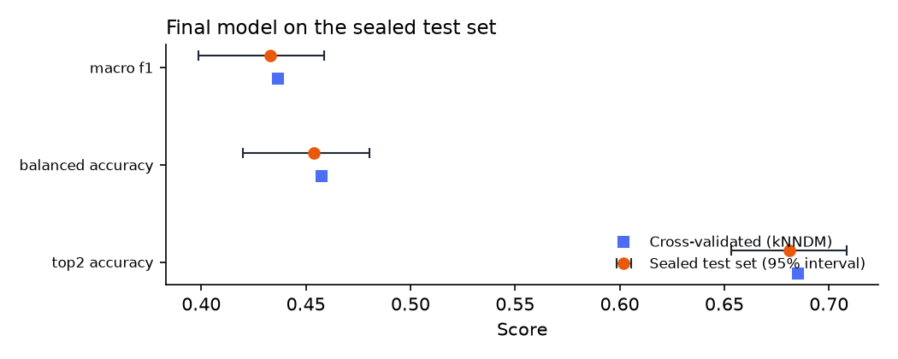

# Validation report: what laboratory soil data add to crop-allocation models for EU farmland

*Development and internal validation of a prediction model (sealed random split)*

Dr. Adewole Olagoke · 22 November 2026

Reported along the TRIPOD+AI checklist (Collins et al., 2024) for the
development and validation of a prediction model, adapted to points rather
than patients. Methods were fixed in a dated [protocol](PROTOCOL.md) before
any model was fitted; amendments A1-A22 record every later change. The final
model is described in the [model card](MODEL_CARD.md) and the data in the
[data card](DATA_CARD.md). Every number below is in
[`reports/tables/`](../reports/tables/).

## Summary

**Question.** Which crop group is grown at a point of EU farmland, and how much
do laboratory soil measurements improve that prediction beyond free climate and
location data?

**Data.** 9,906 LUCAS 2018 topsoil points on farmland in 27 countries, each with
its crop recorded in the field, grouped into eight classes.

**Methods.** Four models and two dummy baselines compared under nested
cross-validation with folds matched to the prediction domain (kNNDM; here this
gave random folds, see Splits). Four pre-registered hypotheses tested
on a predictor ladder with paired spatial block bootstrap, 98.75% intervals,
Holm adjustment and a smallest effect of interest of 0.02 macro F1. One score on
a sealed test set of 1,981 points.

**Results.** A random forest on location, terrain, climate and soil reaches
macro F1 **0.433 (95% interval 0.399 to 0.459)** on the sealed test set,
against 0.437 in cross-validation. Soil adds 0.049 macro F1 beyond climate and
location (H1, supported). Nutrient measurements add more than inherent soil
properties on the primary analysis, the reverse of the prediction (H2), but the
protocol's condition that this hold with organic carbon in either soil block is
not met, so H2's conclusion is not established. Knowing the country adds
nothing (H3a). Macro F1 falls by 0.126 in a country the model has not seen
(H3b).

**Conclusion.** Soil data improve EU-scale crop prediction by a modest,
consistent amount; among the soil variables the fitted model relies most on
total nitrogen, which tracks organic matter (exploratory). The model predicts
crop groups between sample points within the sampled countries; it is not
validated for single fields, new countries, or regional shares of crop groups,
which its class weighting biases.

## Introduction

Climate and location data are free and complete; laboratory soil data are
costly and sparse. Whether the soil measurements of the LUCAS survey add to the
prediction of land use, and which ones, decides whether they are worth
collecting for that purpose. The study tests four hypotheses
([protocol](PROTOCOL.md), amendment A13):

- **H1 (primary).** Laboratory soil measurements add to predictive performance
  beyond geography and climate.
- **H2.** Inherent soil properties (pH, carbonate, texture) add more than
  nutrient measurements (N, P, K), each added on top of geography and climate.
- **H3a.** The country adds predictive performance beyond geography, climate
  and soil.
- **H3b.** A model trained on other countries predicts an unseen country less
  accurately than unsampled farmland within the surveyed countries.

Each is decided against a smallest effect of interest of 0.02 macro F1.

Estimate **E1** describes how macro F1 changes with distance to the nearest
training point (A11).

## Methods

### Data and outcome

- **Source.** LUCAS 2018 topsoil (0-20 cm) with the harmonised land-cover table;
  texture from the 2009-2015 surveys at the same points (A4).
- **Eligibility.** Standard sampling depth, cropland or grassland, agricultural
  land use, a land-cover code in one of the eight groups; Malta excluded
  (2 points). See the [data card](DATA_CARD.md) for the full sample flow.
- **Outcome.** The crop group observed in the field in 2018: wheat, other
  cereals, maize and root crops, oilseeds and pulses, fodder and temporary
  grassland, permanent grassland, vineyards and orchards, olive groves.
- **Predictors.** Four blocks: geography and terrain (G, 4 variables), climate
  1991-2020 (C, 6), inherent soil (S_inh, 5), nutrient soil (S_nut, 4); the
  country (K) only in ladder step 6.
- **Missing data.** Complete cases; 8.6% of points lack clay and silt. Values
  below the detection limit are set to half the limit and flagged (A1).

### Sample size

Before any model was fitted, a precision check simulated the bootstrap
interval for a macro F1 score at this sample size with 50 and 100 km blocks;
its median width, about 0.006, was far inside the protocol's limit of 0.04
([`precision_check.csv`](../reports/tables/precision_check.csv)). The realised
widths are larger and exceed that limit: 0.044 for the cross-validated macro F1
of step 5 and 0.060 for the test score, with the 175 km blocks the variograms
later set (the simulation used smaller blocks and synthetic labels). The
decisions rest on paired differences, whose 98.75% intervals are 0.009 (H3a),
0.022 (H2), 0.025 (H1) and 0.056 (H3b) wide, narrow enough to resolve the 0.02
threshold for H1 and H3a. H2's interval spans −0.02, so its reversal rests on
the point estimate (−0.023), 0.003 beyond the threshold.

### Splits

- **Sealed test set.** One of five kNNDM folds (1,981 points, 20%), chosen so
  that its distances to the training points match those from unsampled EU
  farmland to the sample (medians 8.9 km and 8.5 km). Its point IDs were hashed
  (SHA-256) and committed before exploration; the hash was checked before the
  final fit.
- **What kNNDM chose.** Because unsampled farmland lies as close to the sample
  as random folds do, kNNDM selected one point per cluster, which is random
  k-fold assignment, for the seal and for all three outer repeats
  ([`split_seal.csv`](../reports/tables/split_seal.csv),
  [`knndm_outer.csv`](../reports/tables/knndm_outer.csv)). The sealed test set
  is therefore a random 20% of the points, and the test score measures
  prediction between sample points. Spatial transfer is measured by the block
  and leave-one-country-out schemes (E1, H3b).
- **Cross-validation.** Five-fold kNNDM, repeated three times, assigned on the
  7,925 training points; the models use the 7,252 with every predictor. Four
  inner folds for tuning.
- **Other schemes (E1, H3b).** Random folds, square blocks of 25, 50, 100 and
  200 km, and leave-one-country-out.

### Models

Four models (multinomial logistic regression with natural splines, random
forest, histogram gradient boosting, k-nearest neighbours on coordinates) and
two dummy baselines (majority, stratified). Tuned models had the same budget (60 random-search trials,
log loss). Classes were weighted by inverse frequency. The simplest model
within one standard error of the best mean macro F1 was selected.

### Hypothesis tests

The predictor ladder adds one block at a time (G; + C; + S_inh or S_nut;
both; + K). H1, H2 and H3a each compare two ladder steps fitted on identical
folds; H3b compares step 5 under kNNDM and under leave-one-country-out. Differences are tested with a paired spatial block bootstrap (175 km
blocks, set from the variogram range; 2,000 resamples). A hypothesis is
**supported** if its 98.75% interval's lower bound is above 0 and the estimate
at least 0.02, **negligible** if the interval's upper bound is below 0.02 (for H2, the
whole interval within ±0.02), **reversed** (H2 only) if the upper bound is
below 0 and the estimate at most −0.02, and **inconclusive** otherwise.
p-values are Holm-adjusted over the four tests, with a corrected resampled t
test (Nadeau and Bengio) as a cross-check.

### Performance measures

Macro F1 (primary), balanced accuracy, log loss, Brier score, top-2 accuracy,
per-class F1, top-label and class-wise expected calibration error (15 bins),
macro F1 by country, and Moran's I of the errors.

### Robustness

59 sensitivity runs were made beside a reference run under the same fixed
settings (26 of them informative for H3b): label purity and in-situ observation only; three other treatments of
values below the detection limit; pH in water; another climate period and two
WorldClim resolutions; organic carbon in either soil block, and organic soils
excluded; each country reweighted to its share of farmland points; block
sizes; a climate variable set chosen by clustering; other class-size thresholds and the coarser Level-1
classes; Germany only, the five largest countries, and each country left out;
no class weights; other algorithms; five other seeds (ladder only, so not
for H3b); thinning to 10 km. A
hypothesis is **robust** if no run changes its decision, **mostly robust** if
one does, and **fragile** otherwise (A18). Two negative controls: labels
permuted within country (should fall to the country-only baseline, A19), and an
added noise predictor (should carry no importance).

## Results

### Participants and flow

| Set | Points | With every predictor |
|---|---|---|
| Eligible | 9,906 | |
| Training | 7,925 | 7,252 (673 dropped) |
| Sealed test | 1,981 | 1,800 (181 dropped) |

The test set holds every crop group and every country; its class mix matches
the training set within 1.5 percentage points for every group (other cereals
1.50)
([`split_seal_by_crop_group.csv`](../reports/tables/split_seal_by_crop_group.csv)).

### Model selection

| Model | Macro F1 (cross-validated) |
|---|---|
| Random forest | **0.440** |
| Gradient boosting | 0.433 |
| Logistic regression with splines | 0.406 |
| k-nearest neighbours on coordinates | 0.371 |
| Stratified dummy | 0.123 |
| Majority dummy | 0.054 |

The forest was best by mean and selected (one-SE threshold 0.437).

### Hypotheses

| Ladder step | Blocks | Macro F1 | 95% interval |
|---|---|---|---|
| 1 | G | 0.372 | 0.346 to 0.390 |
| 2 | G + C | 0.388 | 0.363 to 0.406 |
| 3 | G + C + S_inh | 0.403 | 0.377 to 0.422 |
| 4 | G + C + S_nut | 0.427 | 0.402 to 0.445 |
| 5 | G + C + S_inh + S_nut | **0.437** | 0.411 to 0.455 |
| 6 | Step 5 + country | 0.437 | 0.412 to 0.456 |

| | Comparison | Difference | 98.75% interval | Holm p | Corrected t, p | Decision | Robustness |
|---|---|---|---|---|---|---|---|
| H1 | Step 5 − step 2 | +0.049 | 0.037 to 0.061 | 0.004 | 3 × 10⁻⁷ | Supported | Robust (0 of 59 runs disagree) |
| H2 | Step 3 − step 4 | −0.023 | −0.035 to −0.013 | 0.004 | 3 × 10⁻⁴ | Reversed | Fragile (7 of 59) |
| H3a | Step 6 − step 5 | +0.001 | −0.004 to 0.005 | 0.74 | 0.79 | Negligible | Mostly robust (1 of 59) |
| H3b | kNNDM − leave-one-country-out | +0.126 | 0.096 to 0.152 | 0.004 | — | Supported | Robust (0 of 26) |

The bootstrap p-values are bounded below by the 2,000 resamples (about 0.001
before adjustment). The corrected t test agrees with the bootstrap on every
hypothesis; it does not apply to H3b, whose leave-one-country-out side has no
repeated folds.

**H2's status.** On the primary analysis H2 is reversed: nutrients add more
than inherent properties. The protocol, however, requires H2's conclusion to
hold with organic carbon in either soil block. With organic carbon in the
nutrient block the reversal stands; with it in the inherent block the
difference is negligible (−0.004). H2's conclusion is therefore not
established. Of the other disagreeing runs, five give estimates just short of
−0.02 (−0.018 to −0.020) with intervals still below zero (pure labels only, 25
and 50 km blocks, without Ireland, pH in water), and in Germany alone (344
points) the interval crosses zero. The sign is negative in all 59 runs.

*Exploratory.* Total N and organic carbon correlate at 0.94, and total N is the
most important soil variable. The protocol's pre-registered reading of a
reversed or negligible H2 is that it "would point to management, not soil type,
as the soil signal"; organic matter reflects both, so these data cannot
separate them.

### Distance (E1)

| Validation | Median distance to training | Macro F1 |
|---|---|---|
| Random folds | 10.2 km | 0.441 |
| kNNDM (matched to the prediction domain) | 10.2 km | 0.437 |
| 25 km blocks | 15.4 km | 0.426 |
| 50 km blocks | 20.6 km | 0.423 |
| 100 km blocks | 30.5 km | 0.406 |
| 200 km blocks | 49.1 km | 0.389 |
| Leave one country out | 154.9 km | 0.310 |

Macro F1 declines steadily with distance. The pre-registered plateau rule
returns 25 km because the 25-50 km change is small, but it does not describe
the curve; random folds are not biased here because the prediction domain sits
as close to the sample as random folds do.

### Final model on the sealed test set

| Metric | Test | 95% interval | Cross-validated | Test − CV |
|---|---|---|---|---|
| Macro F1 | **0.433** | 0.399 to 0.459 | 0.437 | −0.004 |
| Balanced accuracy | 0.454 | 0.420 to 0.481 | 0.457 | −0.003 |
| Top-2 accuracy | 0.681 | 0.653 to 0.708 | 0.685 | −0.004 |
| Log loss | 1.381 | 1.322 to 1.437 | 1.371 | +0.010 |
| Brier score | 0.651 | 0.623 to 0.676 | 0.643 | +0.009 |

Every cross-validated overall metric lies inside its test interval: the
cross-validation predicted the test macro F1 to within 0.004. Because the test
set is a random 20% of the points (see Splits), this confirms performance
between sample points, not transfer. Six of eight groups score slightly lower
on the test set than in cross-validation, by 0.009 to 0.053; olive groves score
0.010 higher, and vineyards and orchards 0.134 higher (0.581 against 0.447),
with a wide interval (0.459 to 0.671). Bootstrap resamples that lacked a crop
group would have been dropped before the intervals were taken. The scoring
run did not save their number; rebuilt without a model by `final-test-bootstrap`,
it is zero: all 2,000 resamples hold every group
([`final_test_bootstrap.csv`](../reports/tables/final_test_bootstrap.csv), A22).
The tabled estimates are the full-sample differences; the bootstrap medians the
protocol names differ by at most 0.002 and change no decision.
Per-class results, the confusion matrix and results by country are in the
[model card](MODEL_CARD.md) and
[`final_test_*.csv`](../reports/tables/final_test_metrics.csv).

### Calibration

Top-label ECE 0.028 on the test set. Permanent grassland's class-wise ECE is
0.064, above the 0.05 threshold: the balanced class weights move probability
away from permanent grassland, the largest class, so its probabilities are too
low. The Stage A random forest (tuned per fold, with the country) showed the
same pattern in cross-validation (top-label 0.040, permanent grassland 0.073).
As the protocol requires when ECE exceeds 0.05, temperature scaling was fitted
on inner folds in Stage A: it lowered top-label ECE to 0.017 but left permanent
grassland at 0.060, so one temperature cannot remove a single class's bias, and
the final model was left unscaled. Calibration of the final configuration was
not cross-validated separately, and no reliability diagram was drawn for the
test set.

### Interpretation and controls

- **Block importance** (macro F1 lost when a block's values are shuffled
  together in the fitted model; grouped permutation importance, 30 shuffles per
  fold): climate 0.157, geography and terrain 0.103, nutrient soil 0.083,
  inherent soil 0.025. Refitting tells a different story for climate: on the
  ladder it adds only 0.015 to location and terrain, because the two blocks
  carry much the same information.
- **Level-1 classes** (arable, permanent crops, grassland): macro F1 0.760; H1
  +0.073, H2 −0.033, H3a +0.000, H3b +0.081, the same decisions as for the
  eight groups (sensitivity run `level1`).
- **Noise predictor**: 0.002, against 0.025 for the least important block.
- **Test points dropped for missing predictors** (181): by country most in
  France (29), the UK (26), Poland (22), Italy (19) and Ireland (14 of 25); by
  crop group most in permanent grassland (69 of 554), other cereals (32) and
  wheat (27).
- **Labels permuted within country**: 0.226, against 0.216 for a model that
  knows only the country; the excess, 0.009, is below 0.02, so the control
  passes (A19).
- **Spatial errors**: Moran's I 0.14 (p = 0.005); errors cluster, which the
  block bootstrap accounts for.

## Discussion

### Interpretation

Soil measurements add a modest but robust 0.05 macro F1 beyond climate and
location, about three times what climate adds beyond location (0.015). Among
the soil variables the fitted model relies most on total nitrogen (permutation
drop 0.056), which tracks organic matter, and it relies on the nutrient block
most for permanent grassland. Permutation measures reliance, not what a
variable adds; no model without N was refitted. Because organic matter reflects how land has been used, part of
this may be the crop leaving its mark on the soil rather than the soil
deciding the crop; the data cannot tell the two apart.

The country adds nothing once soil and climate are in the model, but a model
trained without a country loses 0.126 in it: the crop mix of a country is
learnable from its neighbours' soil and climate only in part.

### Limitations

- **One season per point.** Arable rotations cap how well the arable groups can
  be separated; their F1 is 0.17 to 0.41.
- **Observational associations.** No causal reading of soil effects.
- **Texture from earlier surveys**, measured 2009-2015 rather than 2018.
- **Complete cases.** 9% of points are dropped, mostly for missing texture,
  and the gaps cluster by country: 83% of points in Luxembourg, 43% in
  Croatia, 32% in Ireland, 31% in the UK and 23% in Finland lack texture, so
  these countries are under-represented. The registered sensitivity run with
  imputation was not built (A21).
- **Random folds.** kNNDM chose random folds, so the cross-validated and test
  scores describe prediction between sample points; transfer over distance is
  given by E1 and H3b only.
- **H2 not established.** Its decision depends on organic matter's assignment,
  which the protocol required it not to.
- **Post-hoc chance level.** Negative control (a)'s baseline was defined after
  its result was seen (A19).
- **Protocol practices not built at the time**, listed in A20: the run log
  and the split-disjointness test (both added since), an end-to-end synthetic
  run, SVG figures, a flag on the sealed-test guard, installation with uv, and
  the EM prior-shift sensitivity run; and, listed in A21, the imputation run.
  The five seed runs covered the ladder only, so H3b was not tested for seeds.
- **Precision underestimated.** The realised interval widths exceed the limit
  the pre-modelling precision check expected to meet; see Sample size.
- **Shares biased.** The balanced class weights shift predicted counts: on the
  test set olive groves are predicted 35% more often than they occur,
  vineyards and orchards 27% and maize 26%, and wheat 15% less often.

### Usability

For predicting the crop group at points between the LUCAS samples in the 27
countries. Not for single fields, years other than 2018, or countries not
sampled; not for regional shares without correcting the class-weight bias
(see Limitations). Any probability map should note permanent grassland's
under-confidence.

## Other information

- **Registration.** No external registry. The protocol was committed to this
  repository on 10 November 2026 before any model was fitted, and amendments
  are dated in it; git commit times are set by the author's machine, so they
  order the work but do not prove it independently.
- **Code and data.** Code: MIT licence, this repository. LUCAS soil data:
  ESDAC licence, not redistributed; only aggregates are published.
- **Funding and interests.** None; an independent portfolio study.
- **AI assistance.** The code and the first drafts of the documents were written
  by an AI coding agent (Claude, Anthropic) under the author's direction; see
  the README section "How this was built".

## References

- Collins, G. S. et al. (2024). TRIPOD+AI statement: updated guidance for
  reporting clinical prediction models that use regression or machine learning
  methods. *BMJ*, 385, e078378.
- Linnenbrink, J., Milà, C., Ludwig, M. & Meyer, H. (2024). kNNDM CV: k-fold
  nearest-neighbour distance matching cross-validation for map accuracy
  estimation. *Geoscientific Model Development*, 17, 5897-5912.
- Orgiazzi, A., Ballabio, C., Panagos, P., Jones, A. & Fernández-Ugalde, O.
  (2018). LUCAS Soil, the largest expandable soil dataset for Europe: a review.
  *European Journal of Soil Science*, 69(1), 140-153.
